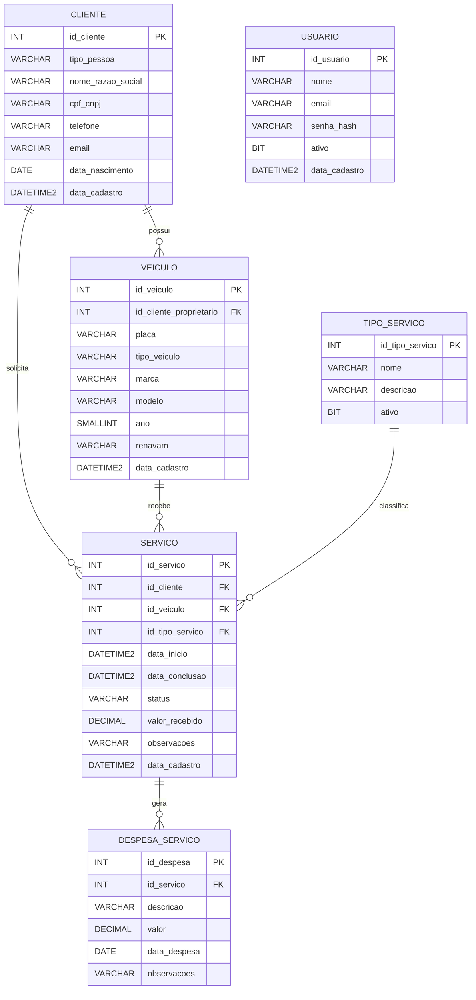

# Despachante Control

Sistema web desenvolvido como projeto de portfólio e extensão acadêmica para apoiar um microempreendimento de despachante documentalista no controle de clientes, veículos, serviços, despesas e resultados financeiros.

O projeto nasceu de uma necessidade real de organização das informações do negócio. Seu foco técnico inicial é a **modelagem relacional e a implementação do banco de dados em SQL Server**, incluindo integridade, consultas analíticas e indicadores financeiros.

## Estado atual do projeto

- **Banco de dados:** modelado, implementado e validado nos cenários de teste realizados no SQL Server.
- **Frontend:** demonstração funcional em React + TypeScript, com nove áreas, dados simulados e alterações mantidas somente em memória. Desenvolvido localmente; ainda não integrado ao banco.
- **Backend/API:** ainda não implementado.
- **Autenticação e persistência reais:** planejadas para a etapa de integração.

> **Importante:** a tela de login atual é demonstrativa. O frontend não consulta nem grava dados no SQL Server e os dados em memória retornam ao estado inicial ao recarregar a aplicação.

## Problema

O controle das atividades do despachante é realizado principalmente em papel e arquivos físicos, dificultando o acompanhamento de:

- clientes e proprietários de veículos;
- veículos vinculados aos atendimentos;
- serviços em andamento, concluídos ou cancelados;
- despesas relacionadas a cada serviço;
- valores recebidos;
- resultados financeiros da operação.

## Objetivo

Centralizar essas informações em uma aplicação web simples, permitindo ao despachante acompanhar a operação e os resultados financeiros com mais organização, rastreabilidade e clareza.

## Stack

### Banco de dados — implementado

- SQL Server
- SQL Server Management Studio (SSMS)
- T-SQL

### Frontend — demonstração implementada

- React
- TypeScript
- Vite
- Playwright (testes de navegador)

### Backend — planejado

- Node.js
- TypeScript
- API para integração com SQL Server

### Ferramentas de desenvolvimento

- Git e GitHub
- Visual Studio Code

## Arquitetura e estágio de integração

A aplicação está organizada em camadas, com responsabilidades distintas:

```text
ATUALMENTE

Frontend React + TypeScript
    ├── Telas e formulários
    ├── Validações e cálculos demonstrativos
    └── Mocks + estado em memória (sem persistência)

Banco de dados SQL Server
    ├── Tabelas e relacionamentos
    ├── Restrições de integridade
    ├── Views e Stored Procedure
    └── Consultas analíticas e índices

As duas partes ainda NÃO estão conectadas.

PRÓXIMA ETAPA

Frontend React + TypeScript
            ↓
API Node.js + TypeScript
            ↓
SQL Server
```

## Banco de dados

A modelagem foi desenvolvida manualmente para representar os relacionamentos e as regras do negócio, com atenção à integridade dos dados e ao uso de consultas para análise operacional e financeira.

### Entidades principais

- `Cliente`: pessoas físicas ou jurídicas cadastradas.
- `Usuario`: usuários administrativos, para a futura autenticação.
- `Veiculo`: veículos e vínculo com o cliente proprietário.
- `TipoServico`: catálogo de tipos de atendimento.
- `Servico`: registro central dos serviços solicitados.
- `DespesaServico`: despesas individuais associadas a cada serviço.

### Relacionamentos

- Cliente **1:N** Veículo (proprietário).
- Cliente **1:N** Serviço (solicitante).
- Veículo **1:N** Serviço.
- Tipo de Serviço **1:N** Serviço.
- Serviço **1:N** Despesa de Serviço.

A entidade `Usuario` foi criada para a futura autenticação administrativa e, no MVP, não possui relacionamento direto com as entidades de negócio.

## Regras de negócio

- O cliente pode ser pessoa física (`PF`) ou jurídica (`PJ`).
- O cliente solicitante do serviço pode ser diferente do proprietário do veículo.
- Um serviço pode ter nenhuma, uma ou várias despesas.
- Um serviço pode ser registrado sem cobrança, com valor recebido igual a zero.
- O custo total e o resultado líquido não são armazenados diretamente; são calculados a partir dos registros existentes.
- Os status permitidos são `EM_ANDAMENTO`, `CONCLUIDO` e `CANCELADO`.
- Serviços cancelados permanecem nos totais financeiros, inclusive quando houve cobrança ou despesa.
- CPF/CNPJ, placa e RENAVAM não podem ser duplicados.
- A data de conclusão não pode ser anterior à data de início.
- Valores recebidos não podem ser negativos.
- Despesas devem ter valor maior que zero.
- Usuários administrativos podem ser desativados sem a exclusão do registro.
- O acesso restrito e a verificação de senhas serão implementados no backend; a autenticação ainda não está ativa.

### Cálculos financeiros

```text
Custo total = soma das despesas do serviço
Resultado líquido = valor recebido - custo total
```

Os cálculos são realizados por meio de agregações e tratam serviços sem despesas, evitando que valores nulos prejudiquem os resultados.

## Diagrama Entidade-Relacionamento (DER)



## Integridade dos dados

O banco utiliza recursos nativos do SQL Server para proteger a consistência das informações:

- `PRIMARY KEY` e `IDENTITY` para identificação dos registros;
- `FOREIGN KEY` para integridade referencial;
- `NOT NULL` para campos obrigatórios;
- `UNIQUE` para evitar duplicidades;
- `CHECK` para validar domínios e regras;
- `DEFAULT` para valores e datas iniciais.

Exemplos implementados:

- `cpf_cnpj`, `placa` e `renavam` são únicos;
- e-mail de usuário é único;
- `tipo_pessoa` aceita apenas `PF` ou `PJ`;
- `status` aceita apenas os três valores definidos;
- `valor_recebido >= 0`;
- `DespesaServico.valor > 0`;
- `data_conclusao` deve ser nula ou maior ou igual a `data_inicio`.

## Views

### `vw_ResumoFinanceiroServico`

Consolida informações operacionais e financeiras por serviço:

- cliente solicitante;
- placa do veículo;
- tipo e status do serviço;
- datas de início e conclusão;
- valor recebido;
- custo total;
- resultado líquido.

O cálculo utiliza `LEFT JOIN`, `SUM` e `COALESCE` para incluir serviços sem despesas e tratar corretamente os totais.

### `vw_DashboardResumo`

Consolida os indicadores gerais:

- total de valores recebidos;
- custos totais;
- resultado líquido;
- quantidade de serviços;
- serviços em andamento.

**Observação:** os totais dessa View consideram os serviços cadastrados, inclusive os cancelados; não representam, por si só, um fluxo de caixa por data de pagamento.

## Stored Procedure

### `sp_ResumoFinanceiroServico`

Retorna o resumo financeiro de um serviço específico, informado por identificador.

```sql
EXEC sp_ResumoFinanceiroServico @id_servico = 4;
```

A procedure foi testada no SSMS com dados de demonstração e seus valores foram confrontados com os da View financeira.

## Índices

Foram criados índices orientados aos padrões de consulta previstos na aplicação:

- `IX_Servico_Status`
- `IX_Servico_DataInicio`
- `IX_DespesaServico_IdServico`

Eles apoiam filtros de serviços por status ou data e a associação entre serviços e despesas. **Não foi realizada medição comparativa de desempenho** antes e depois dos índices.

## Consultas analíticas

O projeto possui consultas para análise operacional e financeira, incluindo:

- **valor recebido associado aos serviços iniciados em cada mês**;
- serviços mais realizados;
- quantidade de serviços por status;
- resumo financeiro por serviço;
- indicadores gerais do dashboard.

A primeira consulta utiliza `data_inicio` como referência temporal. Portanto, **não deve ser interpretada como receita recebida no mês do pagamento**, já que ainda não existe controle de datas de pagamento.

Entre os recursos utilizados estão:

- `INNER JOIN` e `LEFT JOIN`;
- `GROUP BY`;
- `SUM`, `COUNT` e `COALESCE`;
- `YEAR` e `MONTH`;
- `ORDER BY`.

## Dados iniciais (seed)

O script `03_seed_data.sql` cadastra os tipos de serviço padrão:

- Transferência;
- Licenciamento;
- Emplacamento;
- Outros.

A inserção usa `WHERE NOT EXISTS` para evitar registros duplicados quando o script é executado novamente. O seed **não** popula automaticamente clientes, veículos, serviços nem despesas de demonstração.

## Frontend demonstrativo

O frontend foi implementado com nove áreas de navegação e operação:

1. Login demonstrativo;
2. Dashboard;
3. Clientes;
4. Veículos;
5. Serviços (listagem, busca e filtros);
6. Cadastro de serviço;
7. Detalhe do serviço;
8. Despesas do serviço;
9. Resumo financeiro.

Os formulários e componentes compartilhados ficam separados das páginas. As regras e os cálculos da demonstração foram organizados em serviços locais, enquanto os dados simulados permanecem isolados em `mocks`.

### Limitações atuais da demonstração

- O botão de entrada não realiza autenticação real.
- Inclusões e alterações são mantidas apenas em memória.
- Os dados retornam ao estado inicial após recarregar a página.
- O frontend ainda não utiliza a API nem consulta o SQL Server.

Essas limitações são intencionais nesta fase; não se trata ainda de uma aplicação pronta para uso operacional com dados reais.

### Execução local do frontend

Na pasta `frontend/`:

```bash
npm install
npm run dev
```

Abra o endereço local exibido pelo Vite no terminal.

## Autenticação — implementação futura

A tabela `Usuario` já está presente no SQL Server, mas ainda não há autenticação real no frontend.

Fluxo planejado:

```text
React (login)
    ↓
API Node.js + TypeScript
    ↓
Validação de credenciais e usuário ativo
    ↓
SQL Server (Usuario)
```

O backend será responsável por:

- gerar e verificar o hash das senhas, sem armazenar senhas em texto puro;
- validar se o usuário está ativo;
- implementar controle de sessão ou token;
- proteger as rotas da API;
- aplicar as regras de autorização necessárias.

## Testes e validações

### SQL Server — executados no SSMS

- Existência dos objetos principais: **6 tabelas, 2 Views, 1 Stored Procedure e 3 índices**.
- Conferência dos resultados da View de dashboard com dados de demonstração: **R$ 1.850,00 recebidos, R$ 925,00 em custos e R$ 925,00 de resultado líquido**.
- Conferência do resumo financeiro por serviço, incluindo um serviço cancelado sem despesas.
- Execução da Stored Procedure para o serviço de exemplo `4`, com **R$ 1.200,00 recebidos, R$ 640,00 em custos e R$ 560,00 de resultado líquido**.
- Testes de restrições `CHECK`, `FOREIGN KEY` e `UNIQUE`, incluindo rejeição de dados inválidos.
- Validação da consulta mensal e da execução repetida do seed sem duplicação de tipos de serviço.

Os valores acima são **dados de demonstração**, não indicadores reais do empreendimento. Esses testes validam os cenários executados, mas não equivalem a uma suíte exaustiva de testes automatizados do banco.

### Frontend — validação reportada pelo ambiente de desenvolvimento

- Compilação TypeScript e build: aprovados.
- 6 testes de regras de negócio: aprovados.
- 2 testes de navegador com Playwright, incluindo fluxo completo e visualização em celular: aprovados.
- Capturas de tela inspecionadas.
- Ainda não há script de lint configurado.

## Estrutura do projeto

```text
DespachanteControl/
├── README.md
├── database/
│   ├── 01_create_database.sql
│   ├── 02_create_tables.sql
│   ├── 03_seed_data.sql
│   ├── 04_views.sql
│   ├── 05_indexes.sql
│   ├── 06_procedures.sql
│   └── 07_analytical_queries.sql
└── frontend/
    ├── README.md
    ├── package.json
    ├── src/
    │   ├── App.tsx
    │   ├── components/
    │   ├── layouts/
    │   ├── mocks/
    │   ├── pages/
    │   ├── services/
    │   └── types/
    └── tests/
        └── browser/
```

**Observação sobre versionamento:** a implementação do frontend foi concluída localmente, mas ainda não havia sido enviada ao repositório remoto no momento desta atualização. A árvore acima representa a estrutura de trabalho pretendida após o commit e push dos arquivos revisados.

## Como executar os scripts SQL

Em uma instância de desenvolvimento do SQL Server, execute os arquivos da pasta `database/` na ordem:

1. `01_create_database.sql` — cria e seleciona o banco.
2. `02_create_tables.sql` — cria tabelas, chaves e restrições.
3. `03_seed_data.sql` — insere tipos de serviço ausentes.
4. `04_views.sql` — cria ou atualiza as Views.
5. `05_indexes.sql` — cria os índices quando ainda não existem.
6. `06_procedures.sql` — cria ou atualiza a Stored Procedure.
7. `07_analytical_queries.sql` — executa as consultas analíticas.

O script de criação de tabelas destina-se à montagem inicial do banco e **não é idempotente**; executá-lo novamente sobre tabelas já existentes pode gerar erros. Use uma base de teste ao reproduzir a estrutura.

## Decisões técnicas

Algumas decisões importantes tomadas durante a modelagem e a implementação:

- Manter clientes `PF` e `PJ` em uma única entidade.
- Separar o cliente solicitante do cliente proprietário do veículo.
- Registrar despesas em entidade própria, permitindo múltiplos custos por serviço.
- Não armazenar custo total nem resultado líquido, pois são valores derivados.
- Utilizar `DECIMAL(10,2)` para os valores financeiros.
- Utilizar `LEFT JOIN` para incluir serviços sem despesas.
- Utilizar `COALESCE` para evitar resultados nulos nos cálculos financeiros.
- Definir restrições diretamente no banco, sem depender apenas dos formulários.
- Criar índices de acordo com os padrões de consulta previstos.
- Separar a futura autenticação das entidades centrais do negócio.
- Distinguir o protótipo em memória da futura aplicação integrada ao banco.

## Status do projeto

### Banco de dados

- [x] Modelagem conceitual e lógica
- [x] Tabelas e relacionamentos
- [x] Regras de integridade
- [x] Dados iniciais de tipos de serviço
- [x] Views e consultas analíticas
- [x] Índices e Stored Procedure
- [x] Entidade de usuário
- [x] DER e documentação SQL
- [x] Testes manuais dos principais cenários no SSMS

### Aplicação

- [x] Frontend demonstrativo em React + TypeScript
- [x] Nove áreas da interface implementadas
- [x] Validações e cálculos financeiros no frontend
- [x] Testes de regras de negócio
- [x] Testes de navegação e responsividade
- [ ] Backend/API Node.js + TypeScript
- [ ] Autenticação real
- [ ] Integração com SQL Server
- [ ] Persistência dos dados
- [ ] Testes de integração

## Próximas etapas

Com a modelagem do banco concluída e o frontend demonstrativo implementado, as próximas etapas são:

- Desenvolver a API com Node.js e TypeScript.
- Implementar autenticação e autorização para usuários administrativos.
- Conectar o backend ao SQL Server.
- Substituir os dados simulados por operações realizadas por meio da API.
- Implementar persistência de clientes, veículos, serviços e despesas.
- Conectar o dashboard às Views e consultas do banco.
- Realizar testes de integração entre frontend, backend e SQL Server.
- Validar os fluxos completos com dados persistidos.
- Revisar segurança, tratamento de erros e documentação.
- Preparar a disponibilização com acesso restrito.

## Objetivo de portfólio

O Despachante Control é um projeto de portfólio e extensão acadêmica desenvolvido a partir de uma necessidade real. Seu principal objetivo técnico nesta primeira etapa é demonstrar conhecimentos em:

- modelagem de banco de dados;
- SQL Server e T-SQL;
- relacionamentos e integridade referencial;
- `PRIMARY KEY`, `FOREIGN KEY`, `IDENTITY`, `NOT NULL`, `UNIQUE`, `CHECK` e `DEFAULT`;
- consultas com `JOIN`, `GROUP BY` e agregações;
- Views, Stored Procedures e índices;
- validação de regras de negócio;
- construção de indicadores operacionais e financeiros.

O frontend demonstrativo complementa esse trabalho e prepara o projeto para uma segunda etapa: transformar a modelagem e as consultas em uma aplicação completa, integrada e com persistência de dados.
